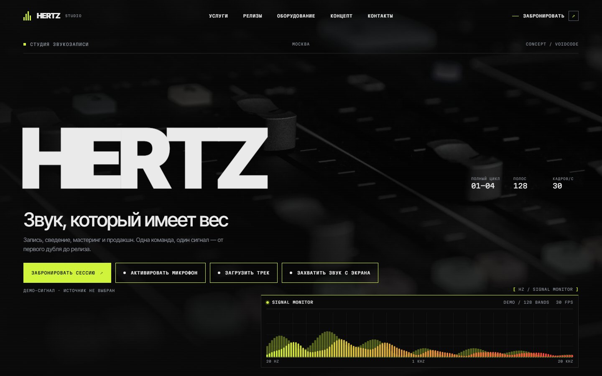
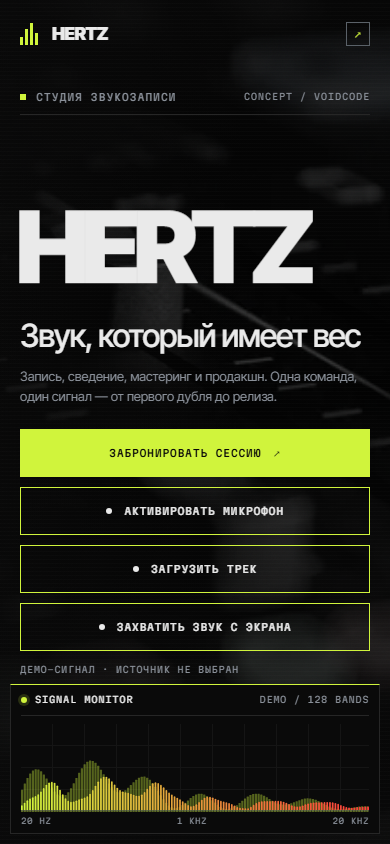

<div align="center">

# HERTZ Studio

**Signature case · премиальный лендинг студии звукозаписи**

Запись, сведение, мастеринг и продакшн. Тёмный Hero, редакционная типографика,
живой аудиосигнал и VHS-каталог релизов.

[Vercel Link](https://hertz-studio.vercel.app)

[](https://astro.build)
[](https://www.typescriptlang.org)
[](https://gsap.com)
[](https://developer.mozilla.org/docs/Web/API/Web_Audio_API)

`npm run verify` — 10/10 проверок

</div>

## Live Demo

[https://hertz-studio.vercel.app](https://hertz-studio.vercel.app)

## Features

- **Аудиовизуализатор · три источника** — микрофон, локальный аудиофайл и захват
  звука вкладки. 128 полос на Canvas + Web Audio API, активный источник подсвечен
  неоновым лаймом. Есть fallback-волна, обработка отказов, 30 fps, пауза в неактивной
  вкладке и статичный постер при `reduce`.
- **GSAP ScrollTrigger** — выезд HERTZ из-под маски, лёгкий параллакс фото пульта,
  последовательное появление услуг и закрывающего слова в футере.
- **VHS-эффекты** — RGB-сдвиг, скан-линии и масштабирование обложки только на hover.
  До наведения каталог остаётся монохромным и тихим.
- **Калькулятор записи** — три шага: услуга, длительность, демо-цена. Ставки вынесены
  в `src/data/pricing.ts`, результат собирается клиентским скриптом.
- **Концепт-блок** — честная светлая плашка VOIDCODE с CTA в Telegram @winteri9.
- **Unsplash-фото** — 6 локальных кадров с атрибуцией в `assets/photos/photos.json`.
  Платные Unsplash+ отсеиваются, размеры и авторы проверяются машинно.
- **Anti-slop** — один кислотный акцент, без градиентного текста, свечений, стекла и
  emoji-иконок. Богатство — в типографике, реальных фото и сигнале.

## Preview

<p align="center">
  
  
</p>

## Стек

- Astro 7.4.7, статическая сборка.
- GSAP 3.15 + ScrollTrigger.
- Canvas 2D + Web Audio API (`AnalyserNode`, 128 полос).
- Inter Tight Variable + Martian Mono, самохостинг через `@fontsource`.
- Без UI-фреймворков и без клиентской гидрации.

## Запуск

```bash
npm install
npm run dev          # http://localhost:4321
npm run build        # astro check + astro build
npm run verify       # типы, сборка, фото, контраст, скриншоты, структура
```

## Структура

```text
src/
  data/              факты: site, services, releases, equipment, pricing, photos
  components/
    SiteHeader.astro
    sections/        Hero, Services, Releases, Equipment, PricingQuiz, Concept, Footer
  layouts/BaseLayout.astro
  scripts/           main, motion (GSAP), visualizer (Canvas/Web Audio), pricing
  styles/            tokens.css, base.css
  pages/index.astro  порядок секций
assets/photos/       6 фото Unsplash + photos.json с атрибуцией
tools/               fetch_photos.py, check-photos.mjs, contrast.mjs, shot.mjs, verify.mjs
screenshots/         финальные снимки 1440 и 390
```

## Проверки

`npm run verify` прогоняет:

1. `astro check` и `astro build`;
2. `check-photos.mjs` — 6 фото, реальные размеры, атрибуция, без Unsplash+;
3. `contrast.mjs` — WCAG-пары (текст ≥ 4.5:1, границы ≥ 3:1);
4. `shot.mjs` — 1440, 390, reduce и no-JS; падает на горизонтальном скролле;
5. `predeploy-check.mjs` — ссылки, заголовки, плейсхолдеры, утечки ключей.

Детали — `docs/ARCHITECTURE.md`. План — `plans/2026-11-07-hertz.md`.

## Важно

HERTZ — концепт VOIDCODE, не реальная студия. Физического адреса, телефона и соцсетей
нет; связь — Telegram [@winteri9](https://t.me/winteri9). Микрофон, файл и захват экрана
требуют разрешения браузера; звук вкладки зависит от выбранного источника.
